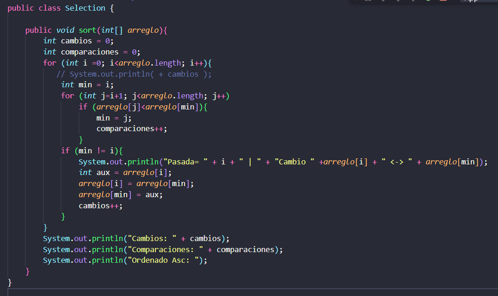
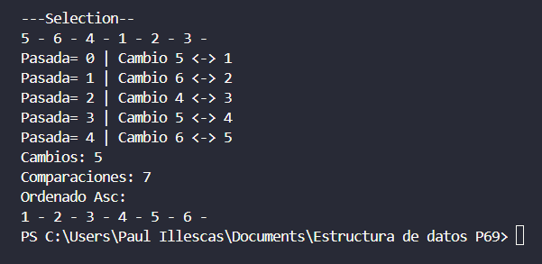

## Practica 2

## Codigo SELECTION

## Consola SELECTION

## Explicacion codigo 

Para imprimir los cambios y las comparaciones, cree las variables [Cambios y comparaciones], para imprimir las pasadas mas los numeros que voy a intercambiar imprimi el arreglo con la su valor en [i] y el arreglo con su valor en [j], para lo demas use sout.