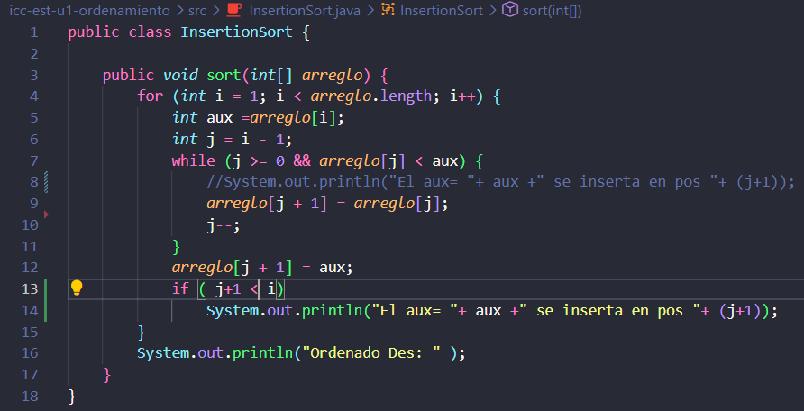
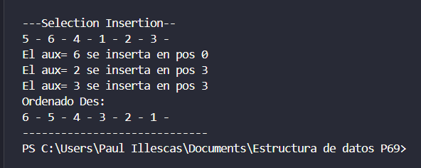

## Insertion Sort 

## Codigo Insercion

## Consola

## Explicacion 

Cambie la condicion del while [<] para que los elementos se ordenaran de manera descendente, de mayor a menor, agrege un println para mostrar el valor de aux, y su posicion final (j+1), solo cuando se realize un intercambio

